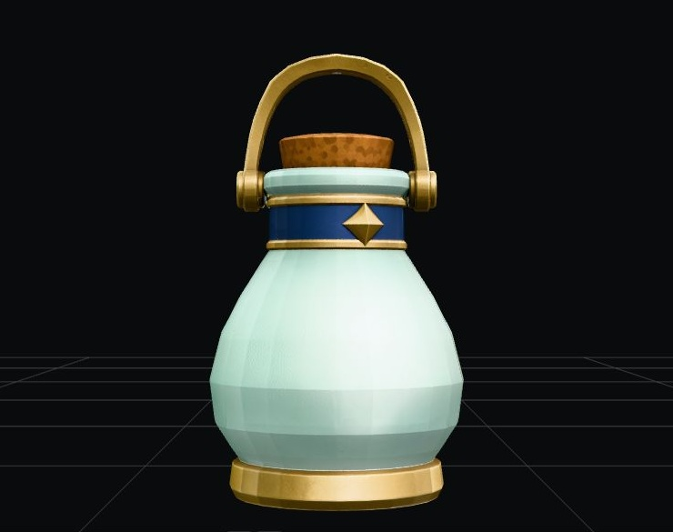
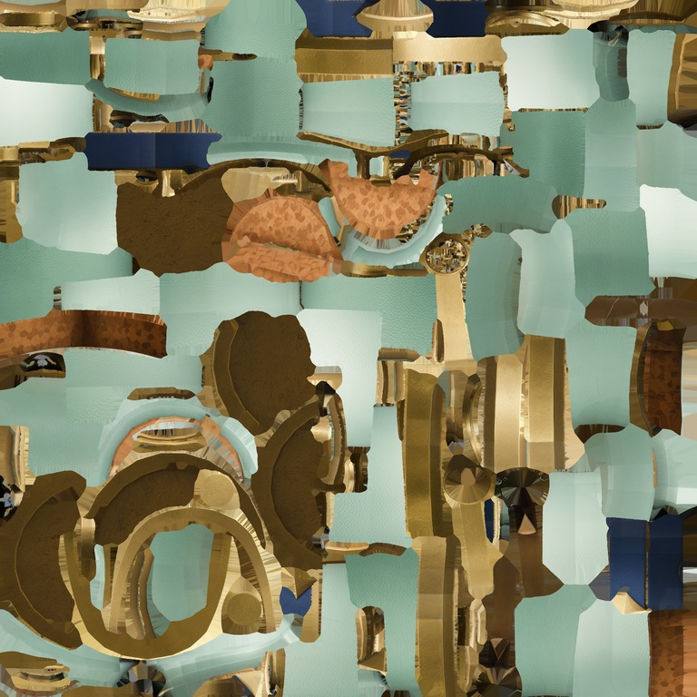

# 반딧불 등대 · 제작 이미지

[제작 요청과 Codex 대화 기록](session-01-codex.md)

## 게임 제작에 사용한 이미지

**반딧불 유리병 모델**  
황동 손잡이와 연한 바다색 몸통이 보이는 VARCO 제작 화면입니다.

**유리병에 입힌 색**  
원본 3D 모델에 들어 있는 텍스처입니다. 유리병을 게임용으로 가볍게 만들 때 이 이미지에서 각 면의 색을 가져왔습니다.

**등대의 불이 꺼진 밤**  
게임을 시작할 때 보여 주는 삽화입니다. 바다에 멈춘 배와 불이 꺼진 등대가 반딧불을 모으는 이유를 보여 줍니다.

